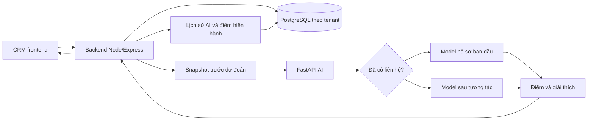

# Báo cáo triển khai dự đoán chuyển đổi lead trong SmartEdu CRM

## 1. Mục tiêu và phạm vi

Chức năng hỗ trợ sale nhận biết tiềm năng, chọn cách tư vấn và ghi nhận kết quả;
quản lý theo dõi tình hình tuyển sinh, nguồn lead và các khách đang bị bỏ sót.
Điểm AI là một đầu vào tham khảo, không tự chuyển giai đoạn hoặc quyết định bỏ lead.

Ba repository tham gia:

| Repository | Vai trò | Nhánh tại lúc rà soát |
|---|---|---|
| SmartEdu_CRM_AI | Xử lý dữ liệu, train, giải thích và cung cấp API dự đoán | feat/lead-scoring-rf-real-data |
| SmartEdu_CRM_BE | Lịch sử liên hệ, snapshot, lưu điểm, phân quyền và thống kê | develop |
| AdminDashboard / SmartEdu_CRM_FE | Kanban, tư vấn, lịch sử và báo cáo quản lý | develop |

Phần dropout được giữ nguyên nghiệp vụ, không nằm trong đánh giá chất lượng model lead.
Chưa triển khai dự báo doanh thu hoặc các chỉ số tài chính mới trong đợt này.

## 2. Rà soát và xử lý các vấn đề ban đầu

Các phiên bản/luồng thử nghiệm trước đây có những vấn đề sau:

- Đặc trưng gần với kết quả chuyển đổi có nguy cơ làm rò rỉ nhãn.
- Một số bộ dữ liệu thử nghiệm tự sinh thuộc tính hoặc thay đổi nhãn kết quả.
- Dùng thời gian trên website thay cho tuổi lead không cùng ý nghĩa nghiệp vụ.
- Dùng lượt truy cập website thay cho số cuộc gọi tạo ra hành vi điểm khó giải thích.
- Ngưỡng HOT/WARM và cách quy đổi xác suất/phần trăm chưa thống nhất.
- Khi AI lỗi, có luồng coi lead như điểm 0/COLD thay vì giữ kết quả trước đó.
- Giải thích SHAP và điểm cuối có thể không cùng phạm vi mô hình.
- Giao diện không thể hiện rõ dữ liệu của lần chấm nào, chưa hiển thị kết quả liên hệ.

Đã chuyển sang các phép biến đổi xác định, không dùng `Converted` hoặc `Tags`
để tạo đặc trưng. Nhãn `Converted` chỉ được dùng làm biến đích khi train/đánh giá.
Không tự thêm năm học, mục tiêu hoặc khóa học bằng ngẫu nhiên. Không biến giây
truy cập thành số ngày tồn tại của lead.

Điều này loại bỏ các cách tạo đặc trưng không hợp lệ đã xác định được; chưa thể
khẳng định dữ liệu public hoàn toàn đúng thời điểm dự báo vì thiếu lịch sử thời gian.

## 3. Dataset và đặc trưng hiện tại

Nguồn baseline: X Education, file `dataset/archive/Lead Scoring.csv`, 9.240 bản ghi.
Dataset đã xử lý: `dataset/archive/lead_scoring_real_dataset.csv`.

| Đặc trưng | Dữ liệu public | Dữ liệu CRM |
|---|---|---|
| Source_Group | Lead Source | lead_source, gom cùng nhóm nguồn |
| Occupation_Group | What is your current occupation | occupation, gom sinh viên/người đi làm/... |
| Goal_Group | What matters most to you in choosing a course | study_purpose, gom mục tiêu học |
| Engagement_Group | Phản hồi email, cuộc gọi, chat hoặc tình trạng không tiếp cận được | Kết quả liên hệ thực tế đã ghi nhận |

`TotalVisits` và `Call_Attempt_Count` không phải đặc trưng của hai model public
hiện tại. Các count thật vẫn được lưu trong snapshot để phục vụ nghiệp vụ và
model CRM về sau. Khóa quan tâm và tuổi lead cũng chưa dùng trong baseline public.

Danh mục nguồn do backend quản lý tại `src/constants/leadSources.ts`, cung cấp qua
`GET /api/leads/sources`. Tạo/sửa, bộ lọc, Kanban, chi tiết và báo cáo dùng cùng
giá trị lưu DB: `facebook`, `google_ads`, `website_organic`, `website`, `zalo`,
`tiktok`, `referral`, `other`. Nguồn lịch sử ngoài danh mục được giữ nguyên,
không tự đổi sang nguồn khác hoặc cho phép tạo nguồn tùy ý.

Giới hạn của dữ liệu nguồn:

- Mục tiêu public chủ yếu có `career` và `unknown`; mục tiêu thi chứng chỉ/du học
  của CRM chưa có nhóm tương ứng đủ bằng chứng trong dữ liệu nguồn.
- Nhóm mạng xã hội chỉ có 57 bản ghi trong toàn bộ dữ liệu public.
- Nhiều hồ sơ sau khi gom nhóm có đặc trưng giống nhau dù là các lead khác nhau.
- Không có thời điểm chuyển đổi/lịch sử liên hệ đầy đủ để dựng lại chính xác
  trạng thái lúc khách vừa để lại thông tin.

## 4. Model đã train và cách chọn giai đoạn

Phiên bản: `lead_staged_rf_3`.
Artifact: `ai_models/lead_scoring_v2_rf_pipeline.pkl`.
Tên file được giữ để tương thích cấu hình triển khai; bên trong chứa hai pipeline.

| Trường hợp | Pipeline và dữ liệu sử dụng |
|---|---|
| Chưa có liên hệ được ghi nhận | Model ban đầu, chỉ nguồn + nghề nghiệp + mục tiêu |
| Đã liên hệ nhưng chưa có kết quả | Giữ điểm hồ sơ ban đầu, trả trạng thái chờ phản hồi |
| Có kết quả liên hệ | Model sau tương tác, bổ sung nhóm phản hồi |
| Có model CRM được duyệt về sau | Dùng model lịch sử CRM sau liên hệ; giai đoạn đầu vẫn dùng ba thuộc tính hồ sơ |

Backend xác định `Has_Contact_Activity` từ call/email/SMS/meeting thật.
Ghi chú nội bộ hoặc chuyển cột Kanban không được coi là liên hệ khách hàng.
Email/cuộc hẹn cũ ngoài 7 ngày vẫn được nhận diện dù chưa có cuộc gọi nào.

Model ban đầu là đánh giá theo hồ sơ khi chưa có liên hệ được ghi nhận, không
khẳng định lead đó vừa được tạo hoặc chưa từng được tư vấn ngoài hệ thống.

Cấu hình train:

- Random Forest: 250 cây, max_depth 14, min_samples_split 8, min_samples_leaf 4,
  class_weight balanced, random_state 42.
- Chia train/test 80/20 có stratify: 7.392 train, 1.848 test.
- So sánh ứng viên bằng 5-fold CV chỉ trên train; không dùng test để chọn đặc trưng.
- Mỗi fold hiệu chỉnh xác suất fit encoder và forest riêng; hiệu chỉnh isotonic.
- Chỉ bổ sung nhóm phản hồi khi CV AUC cải thiện vượt ngưỡng 0,005 so với model đơn giản.

Ngưỡng giữ thống nhất: HOT >= 80%, WARM >= 50%, COLD < 50%.
Đây là quy ước phân nhóm điểm, không phải bằng chứng khách sẽ đăng ký.

### Kết quả trên tập test public

| Cách đánh giá | Accuracy | Precision tại 50% | Recall tại 50% | F1 | ROC-AUC | Brier |
|---|---:|---:|---:|---:|---:|---:|
| Model ban đầu | 71,65% | 88,21% | 30,48% | 0,4530 | 0,7427 | 0,1875 |
| Model sau tương tác | 72,35% | 73,99% | 43,54% | 0,5482 | 0,7685 | 0,1814 |
| Luồng định tuyến theo phản hồi nguồn | 71,54% | 88,11% | 30,20% | 0,4498 | 0,7649 | 0,1861 |

Hai model riêng được so sánh trên cùng tập test. Luồng định tuyến dùng sự có mặt
của phản hồi public làm dấu hiệu thay thế vì nguồn không có thời điểm liên hệ.
Các số liệu này không phải độ chính xác trên CRM và không chứng minh xác suất
của lead mới tại trung tâm. Không tiếp tục dùng kết quả của bản proxy cũ để
mô tả model đã tách giai đoạn.

Chi tiết và hash artifact/dataset nằm trong `ai_models/lead_scoring_real_rf_results.json`.
Báo cáo metric sinh bởi trainer nằm trong `ai_models/lead_scoring_report.md`.
Sáu ảnh trong `ai_models/reports` hiện minh họa pipeline sau tương tác trên dữ liệu public.

## 5. Giải thích kết quả

API dự đoán và API giải thích dùng cùng pipeline đã chọn theo giai đoạn.
SHAP tổng hợp đóng góp từ toàn bộ forest của các fold hiệu chỉnh, lấy đúng lớp
chuyển đổi và kiểm tra tính cộng được của các đóng góp.

SHAP giải thích trung bình đầu ra forest trước hiệu chỉnh, không phải phép phân
rã chính xác điểm sau hiệu chỉnh. Thiếu SHAP hoặc lỗi giải thích không làm mất dự đoán.
Model ban đầu không hiển thị yếu tố tương tác vì không dùng đặc trưng đó.

Các yếu tố nguồn/nghề nghiệp là quan hệ thống kê, không phải lý do thật khiến
khách chưa đăng ký. Gợi ý tư vấn đặt câu hỏi để sale ghi nhận trở ngại thực tế.

Ví dụ đã kiểm tra: hồ sơ giới thiệu + người đi làm + mục tiêu công việc có điểm
ban đầu 97,69%. Trong train, nhóm tương ứng có 144/148 bản ghi chuyển đổi.
Kết quả giải thích được theo dữ liệu nguồn nhưng không có nghĩa lead CRM đó
chắc chắn đăng ký. Không giới hạn điểm hoặc cộng/trừ phần trăm tùy ý để số trông hợp lý hơn.

## 6. Tích hợp vào backend CRM



Luồng tạo/chăm sóc lead:

1. Backend lưu lead hoặc activity; chỉ liên hệ thật mới cập nhật `last_contacted`.
2. Liên hệ thật đầu tiên có thể chuyển lead `new` sang `contacted`.
3. Tác vụ chấm điểm đọc snapshot từ dữ liệu quan sát tại thời điểm đó.
4. Backend gọi `/explain-lead-v2`, kiểm tra phiên bản, thang điểm và giai đoạn trả về.
5. Trong transaction theo tenant, append lịch sử `ai_predictions` và cập nhật
   `lead_ai_scores` khi response còn hợp lệ, dữ liệu chưa bị thay đổi/ghi đè.
6. Frontend đọc lại điểm, giai đoạn và lịch sử để hiển thị hướng tư vấn.

Chấm tự động sau tạo lead, liên hệ thật hoặc thay đổi thuộc tính liên quan;
có thể chấm thủ công. Request ghi activity không phải chờ AI suy luận xong.

Khi AI timeout/lỗi hoặc response cũ: giữ điểm trước, đánh dấu tình trạng hiện tại;
không lưu điểm 0 giả. Lead đã đăng ký/thất bại không tiếp tục được chấm như cơ hội mở.
Khóa theo lead và fingerprint bảo vệ việc response cũ ghi đè dữ liệu mới.

Phân quyền admin/sale và tenant/RLS hiện có được giữ. Sale chỉ xem/chỉnh sửa
lead thuộc phạm vi được phân công; export dữ liệu train chỉ dành cho admin tenant.
Không cần migration schema cho phần snapshot vì tái sử dụng JSON trong lịch sử AI.

Trong quá trình sửa lỗi khởi động cũng đã khôi phục `invoice.service.ts` bị thiếu
từ Git. File này hiện không còn diff so với phiên bản đã commit.

## 7. Dataset CRM và lộ trình train lại

Snapshot lưu thông tin nguồn, nghề nghiệp, mục tiêu, khóa, kết quả liên hệ, số
cuộc gọi/kết nối, số hoạt động 7 ngày, tuổi lead và thời gian từ lần liên hệ gần nhất.
Không đưa họ tên, điện thoại, email hoặc nội dung ghi chú vào dataset xuất train.

Admin export qua `GET /api/leads/scoring-dataset`, tối đa 50.000 snapshot mỗi lần.
Nhãn `converted_30d=1` khi Student liên kết được tạo sau snapshot và trong 30 ngày.
Chờ đủ cửa sổ cho cả trường hợp đã chuyển đổi và chưa chuyển đổi. Chưa đủ thời
gian thì nhãn null; không đoán là thất bại. Bản ghi thiếu mốc chuyển đổi đáng tin
cậy được loại thay vì tự gán nhãn.

Trainer `train_crm_lead_scoring.py` đã chuẩn bị:

- Chỉ nhận cohort sau liên hệ thật, khớp giai đoạn mà model lịch sử sẽ phục vụ.
- Tối đa một snapshot/lead/ngày; không chọn mẫu theo kết quả để làm đẹp dữ liệu.
- Chia các lead theo thời gian thành train/validation/test; cùng lead không nằm
  ở nhiều tập. Loại mẫu có cửa sổ nhãn lấn sang mốc tập kế tiếp.
- Hiệu chỉnh có nhóm theo lead; chọn độ sâu RF bằng validation PR-AUC.
- Lưu candidate và báo cáo mặc định. Chỉ kích hoạt bằng `--activate` khi đạt gate:
  precision nhóm >=80% ít nhất 85%, có >=20 lead HOT khác nhau ở cả validation và test.

Chưa có model CRM sản xuất đã train/duyệt bằng dữ liệu thực của trung tâm.
Fixture nhân tạo chỉ dùng kiểm thử, không được dùng để công bố chất lượng model.
Model CRM cho giai đoạn ban đầu chưa được triển khai; hiện giai đoạn này vẫn dùng baseline public.
Các ngưỡng đủ dữ liệu tối thiểu không phải bảo đảm độ chính xác hoặc chỉ cần đợi 30 ngày.

## 8. Giao diện và nghiệp vụ sử dụng điểm

- Giữ các giai đoạn CRM: mới, đã liên hệ, quan tâm, học thử, đăng ký, thất bại.
- Bỏ tag/bộ lọc “Cần chăm sóc sớm” vì quy tắc quá rộng; giữ bộ lọc chưa liên hệ/quá 3 ngày.
- Điểm kèm trạng thái đánh giá ban đầu/sau tương tác/chờ phản hồi; điểm cũ có ghi chú.
- Trang chi tiết đưa việc nên làm và câu hỏi tư vấn lên trước; giải thích AI thu gọn.
- Điểm cao nhưng chưa liên hệ: xác minh nhu cầu. Có phản hồi tích cực và điểm cao:
  hỗ trợ quyết định đăng ký. Điểm thấp: hỏi trở ngại. Từ chối: tôn trọng khách,
  ghi lý do và chỉ tiếp tục khi phù hợp.
- Không có quy tắc tự động bỏ lead chỉ vì điểm thấp. Câu hỏi tư vấn là rule trong
  `leadGuidance.ts`, không phải model tự biết khách thiếu tiền hay bận lịch.
- Lịch sử call/email/SMS/tư vấn/note/chuyển giai đoạn có kết quả và người ghi;
  phân trang 20 bản ghi, phân biệt lỗi tải với lịch sử trống.
- Tìm kiếm và bộ lọc được thực hiện ở backend; Kanban có phân trang rõ ràng.
  Thống kê dùng aggregate theo cùng bộ lọc, không đếm riêng trang đang tải.
- Quản lý xem lead đang chăm sóc, cần liên hệ, chưa phân công, đăng ký và hiệu quả nguồn.
  Bỏ báo cáo “doanh thu kỳ vọng AI”; giá trị học phí cơ hội không gọi là tiền đã thu.
- Luồng đăng ký trên UI có xác nhận tạo học viên; kết thúc lead yêu cầu ghi lý do.

## 9. Docker và trạng thái chạy

AI là một FastAPI service trên port 8000, có thể load lead và dropout trong cùng
container. Không cần thêm container riêng cho mỗi model ở quy mô hiện tại.

- Đổi code/thư viện: rebuild image.
- Chỉ thay artifact trong volume `ai_models`: restart để load lại vào RAM.
- `dataset`, test, docs, ảnh báo cáo và file môi trường bị loại khỏi build context.
- Backend chạy trên host dùng `127.0.0.1:8000`; backend trong cùng Docker network
  dùng tên service `smartedu-ai`, không dùng localhost của chính container backend.

Khi rà soát, `GET http://127.0.0.1:8000/` trả `healthy`,
`lead_model_version=lead_staged_rf_3` và các model lead/dropout đã load.
Đây là xác nhận service local; không phải xác nhận deploy production hoặc test
trực quan UI. Các thay đổi cleanup mới nhất chưa được tự rebuild/deploy trong đợt báo cáo.

Model legacy `/predict-lead` và artifact cũ được giữ để tương thích, đánh dấu
deprecated; CRM sử dụng các endpoint v2. Chất lượng model legacy không được coi
là chất lượng của model đang tích hợp CRM.

## 10. Dọn code và file

Đã bỏ comment diễn giải từng bước, comment nhắc sai XGBoost, đoạn auth giả bị
comment, cấu hình/hàm không có caller và icon trang trí ở tab/menu. Giữ comment
giải thích các ràng buộc quan trọng: tenant, transaction, nhãn theo thời gian,
điểm 0 thật so với thiếu điểm và pipeline mà SHAP giải thích.

Avatar không đổi màu theo điểm AI; giữ icon thao tác quen thuộc như gọi điện,
thêm, tải lại và menu. Bỏ nút ghi liên hệ lặp trong panel tư vấn.

Các file không còn thuộc workflow lead đã xóa:

- `ai_models/compare_lead_scoring_models.py`
- `ai_models/generate_lead_scoring_v2_dataset.py`
- `ai_models/train_lead_scoring_v2.py`
- `ai_models/train_lead_scoring.py`
- `ai_models/preprocessing_utils.py` sau khi kiểm tra artifact hiện có không tham chiếu helper này.
- `ai_models/lead_scoring_v2_xgb_pipeline.pkl`
- `ai_models/precision_recall_curve.png`
- `ai_models/calibration_reliability_curve.png`
- `dataset/archive/lead_scoring_v2_dataset.csv`
- `dataset/archive/Lead Scoring_Enhanced.csv`

Các file tracked có thể khôi phục từ lịch sử Git; chưa commit hoặc xóa lịch sử Git.
Giữ dataset gốc, artifact phục vụ runtime/fallback, trainer hiện hành, test và
báo cáo mới. Dữ liệu OULAD chưa track được giữ nguyên, không thuộc PR lead.

Test được tách theo repository: backend không import frontend ở thư mục bên cạnh.
Frontend dùng Node test runner và Vite sẵn có, không thêm framework/dependency mới.

## 11. Kiểm thử và giới hạn xác minh

| Phần | Kết quả |
|---|---|
| AI | 25 test lead: dữ liệu độc lập nhãn, stage routing, SHAP, artifact/hash, temporal CRM training |
| Backend | 36 test unit/API mock: response, snapshot, timeout, concurrency, nguồn và filter/phân quyền sale |
| Frontend | 10 test rule/SSR: tư vấn theo bằng chứng, nguồn, thang điểm và cách hiển thị thống kê |
| TypeScript backend | Kiểm tra toàn backend |
| TypeScript CRM | Kiểm tra tập trung các màn hình CRM |
| Frontend build | Vite build |

Test unit/SSR không thay thế chạy E2E bằng trình duyệt và database thật.
Kiểm tra toàn frontend vẫn có lỗi có sẵn ngoài phạm vi CRM; chưa xử lý trong đợt này.
Các artifact legacy có thể phát cảnh báo khác phiên bản scikit-learn khi load;
không lấy việc load được làm bằng chứng đã kiểm thử đầy đủ suy luận dropout/legacy.

Lệnh kiểm tra (chạy trong từng repository):

```powershell
# SmartEdu_CRM_AI, với Python environment đã cài requirements-explain.txt
python -m unittest discover -s tests -p "test_*lead*.py" -q

# SmartEdu_CRM_BE
npm.cmd run typecheck
npm.cmd test -- tests/lead-scoring.test.ts tests/lead-sources.test.ts tests/lead-filters.test.ts

# AdminDashboard
npm.cmd run test:crm
npm.cmd run build
```

## 12. Commit và PR đề xuất

Chưa thực hiện commit, push hoặc tạo PR. Các lệnh dưới đây do người dùng chạy
từ `D:\KiemTra\Hoc_ky_8\DACN_3`. Kiểm tra `git diff --cached` trước khi commit.
Base đề xuất là `develop` của từng repo; không commit trực tiếp frontend/backend
trên nhánh develop. Không dùng `git add .` cho AI để tránh đưa OULAD vào PR.

### AI

Commit: `feat(ai): add staged lead scoring and CRM snapshot training`

PR title: `Add staged lead scoring and CRM retraining support`

PR body:

```text
Train separate intake and post-contact reference pipelines from X Education.
Remove invalid visit-to-call proxies and synthetic/label-modifying experiments.
Keep prediction and SHAP on the same selected pipeline; preserve API compatibility.
Add grouped temporal CRM training with a 30-day outcome window and activation gate.
Document source-domain metrics, CRM limitations, Docker rollout and code cleanup.

Validation: 25 lead tests. Public scores are not validated CRM conversion probabilities.
No approved production CRM artifact is included. Dropout business logic is unchanged.
```

```powershell
git -C SmartEdu_CRM_AI add -u
git -C SmartEdu_CRM_AI add ai_models/lead_contract.py ai_models/staged_lead_scoring.py ai_models/train_crm_lead_scoring.py ai_models/lead_scoring_report.md requirements-explain.txt docs tests
git -C SmartEdu_CRM_AI diff --cached --stat
git -C SmartEdu_CRM_AI commit -m "feat(ai): add staged lead scoring and CRM snapshot training"
git -C SmartEdu_CRM_AI push -u origin feat/lead-scoring-rf-real-data
gh pr create --repo ChauKnockUI/SmartEdu_CRM_AI --base develop --head feat/lead-scoring-rf-real-data --title "Add staged lead scoring and CRM retraining support" --body "Add staged reference models, consistent SHAP, gated CRM retraining, evaluation reports and cleanup. Public-data scores remain unvalidated on CRM outcomes. Validation: 25 lead tests."
```

### Backend

Commit: `feat(crm): integrate lead scoring snapshots and care workflows`

PR title: `Integrate staged scoring, snapshots and lead source catalog`

PR body:

```text
Integrate the staged AI contract and validate scoring stage against actual contact history.
Preserve previous scores when AI fails; persist immutable tenant-scoped snapshots.
Add admin dataset export, a shared source catalog and consistent create/update validation.
Support server-side course/care/search filters and aggregate statistics for CRM views.
Keep real contact updates separate from internal notes; remove stale comments/dead helpers.

Validation: backend typecheck and 36 unit/API-mock tests. No schema migration required.
Coordinate rollout with the lead_staged_rf_3 AI service and the CRM frontend.
```

```powershell
git -C SmartEdu_CRM_BE switch -c feat/lead-scoring-crm
git -C SmartEdu_CRM_BE add src/controllers/lead.controller.ts src/repositories/lead.repository.ts src/routes/lead.routes.ts src/services/lead.service.ts "src/services/ai/leadScoring.*" src/constants/leadSources.ts tests/lead-scoring.test.ts tests/lead-sources.test.ts tests/lead-filters.test.ts
git -C SmartEdu_CRM_BE diff --cached --stat
git -C SmartEdu_CRM_BE commit -m "feat(crm): integrate lead scoring snapshots and care workflows"
git -C SmartEdu_CRM_BE push -u origin feat/lead-scoring-crm
gh pr create --repo ChauKnockUI/SmartEdu_CRM_BE --base develop --head feat/lead-scoring-crm --title "Integrate staged scoring, snapshots and lead source catalog" --body "Integrate staged AI responses, immutable snapshots, source validation, dataset export and server-side CRM filters. Preserve scores on AI failures. Validation: typecheck and 36 tests. No database migration."
```

### Frontend

Commit: `feat(crm): simplify lead management and consultation UI`

PR title: `Improve lead pipeline, consultation guidance and reporting`

PR body:

```text
Keep the existing CRM funnel and Ant Design style while simplifying tabs, actions and icons.
Show assessment stage, concrete consultation guidance and customer questions.
Add paginated history/board views and use backend filters and aggregate statistics.
Share source labels from the API; replace AI revenue claims with observed CRM results.
Require explicit registration confirmation and a reason when closing a lead.
Add standalone CRM rule/SSR tests without new dependencies.

Validation: 10 CRM tests, scoped CRM typecheck and Vite build.
Full-project typecheck still has pre-existing errors outside CRM; browser E2E was not run.
Requires the updated CRM backend. No model retraining is needed for frontend-only changes.
```

```powershell
git -C AdminDashboard switch -c feat/lead-consultation-ui
git -C AdminDashboard add .gitignore package.json src/features/crm src/services/api/lead.service.ts tests/crm.test.mjs
git -C AdminDashboard diff --cached --stat
git -C AdminDashboard commit -m "feat(crm): simplify lead management and consultation UI"
git -C AdminDashboard push -u origin feat/lead-consultation-ui
gh pr create --repo ChauKnockUI/SmartEdu_CRM_FE --base develop --head feat/lead-consultation-ui --title "Improve lead pipeline, consultation guidance and reporting" --body "Simplify CRM views, add evidence-based consultation guidance and paginated history, share source labels and show observed business results. Validation: 10 CRM tests, scoped typecheck and Vite build. Full frontend typecheck has pre-existing unrelated errors; browser E2E was not run."
```

Các lệnh `gh` yêu cầu GitHub CLI đã đăng nhập. Có thể tạo PR trên GitHub UI và
copy title/body tương ứng ở trên. Không chạy lại `switch -c` nếu nhánh đã được tạo.
Triển khai phối hợp theo thứ tự AI -> backend -> frontend để tránh lệch hợp đồng API.
